  

 

<table>
  <tr>
    <td><b>Frontend</b></td>
    <td>&nbsp;&nbsp;&nbsp;</td>
    <td>HTML · CSS · JavaScript · React</td>
  </tr>
  <tr>
    <td><b>Backend</b></td>
    <td>&nbsp;</td>
    <td>C# · PHP</td>
  </tr>
  <tr>
    <td><b>Bases de datos</b></td>
    <td></td>
    <td>SQL</td>
  </tr>
  <tr>
    <td><b>Control de versiones</b></td>
    <td>&nbsp;</td>
    <td>Git · GitHub</td>
  </tr>
</table>

  

